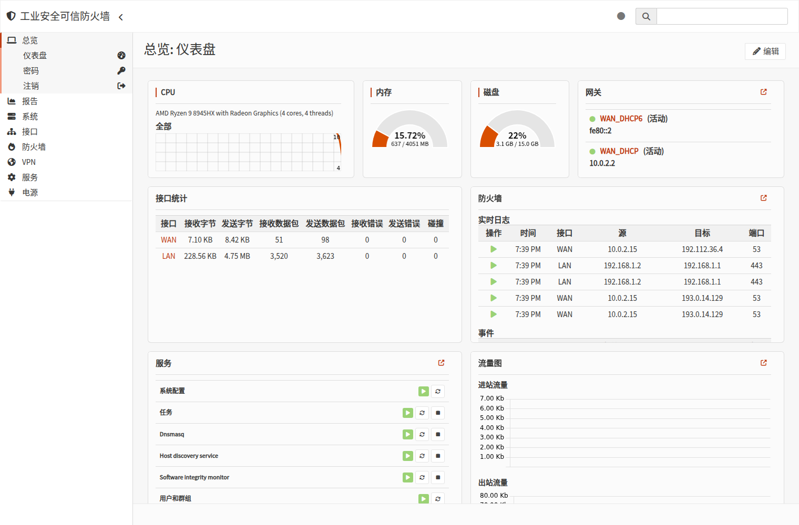

# Industrial Firewall · 工业可信防火墙

Industrial Firewall 是面向工业网络与企业网络边界的开源防火墙系统，基于 FreeBSD 和 OPNsense 构建。系统通过统一的 Web 管理界面提供网络访问控制、入侵检测与防御、VPN、工业协议白名单、应用识别和下载防病毒，并支持网关侧微隔离与软件完整性监测。

[下载安装镜像](https://github.com/Sebastian6848/Industrial-Firewall/releases/latest) · [安装与使用说明](docs/manual/安装与使用说明.md) · [功能说明](docs/FEATURE_REVIEW.md) · [版本验证报告](docs/RELEASE_TEST_REPORT.md) · [开发指南](docs/DEVELOPMENT.md)

## 主要功能

| 功能 | 说明 |
| --- | --- |
| 网络与访问控制 | 接口、VLAN、路由、状态防火墙、NAT、DHCP 与 DNS |
| 入侵检测与防御 | 基于 Suricata 的 IDS/IPS、签名规则和告警查询 |
| 工业协议白名单 | 按设备、地址、端口和协议操作限制通信，支持 Modbus TCP、DNP3、S7comm、MQTT、NC-Link 等协议 |
| 应用识别 | 基于 ntopng/nDPI 和域名特征展示应用流量；统一管理内置与自定义规则，支持 JSON/CSV 批量导入 |
| 下载防病毒 | 在一个页面配置、启停和诊断 ClamAV、C-ICAP 与 Squid 扫描链路，独立管理病毒库更新 |
| 网关侧微隔离 | 设备分组、组间访问矩阵、策略预览、应用与回退 |
| 软件完整性 | 文件基线、定时校验与变化审计 |
| VPN 与高可用 | IPsec、OpenVPN，以及 CARP、pfsync 和配置同步 |
| 集中管理 | 通过 HTTPS/API 查询受管节点状态、审计记录并分发隔离策略 |
| 插件扩展 | 使用与系统分支、ABI 匹配的签名插件仓库 |

工业协议的解析范围与限制见[协议说明](plugins/security/icsguard/README.md)，NC-Link 的承载和控制粒度见[NC-Link 支持说明](docs/NCLINK_ASSESSMENT.md)。

## 下载与安装

从 [GitHub Releases](https://github.com/Sebastian6848/Industrial-Firewall/releases/latest) 下载 amd64 安装镜像、SHA-256 校验文件和 PDF 手册。镜像以单个 `.iso.bz2` 文件发布，解压后得到可挂载的 `.iso`。

    sha256sum --ignore-missing -c SHA256SUMS
    bzip2 -dk industrial-firewall-2026.11.16-amd64.iso.bz2
    sha256sum --ignore-missing -c SHA256SUMS

建议配置：amd64 CPU、4 核、8 GB 内存、40 GB 系统盘，以及用于 WAN/LAN 的两张网卡。吞吐、连接数和日志存储应按实际业务另行规划。

1. 将 ISO 挂载到虚拟光驱，从安装介质启动。
2. 以 `installer` 登录，初始介质口令为 `opnsense`。
3. 选择安装目标磁盘，并设置新的管理员口令。
4. 从系统盘启动，在 LAN 访问 `https://192.168.1.1/`。
5. 完成接口、管理证书和访问策略配置。

安装会清空所选磁盘。详细步骤、界面截图及排障方法见[安装与使用说明](docs/manual/安装与使用说明.md)。

## 部署范围

- 工业协议的在线阻断需要正确启用内联 IPS，并验证实际网卡及流量路径；部分协议采用有限报文特征。
- 默认下载防病毒检查显式代理上的可见 HTTP 内容，HTTPS 解密需要独立设计和配置。
- 微隔离作用于经过防火墙的流量；同一二层网络中的直连通信需要交换机、VLAN 或其他控制点配合。
- 完整性监测采用软件基线。硬件信任根、远程证明、VPN 容量与双机切换指标的状态见[版本验证报告](docs/RELEASE_TEST_REPORT.md)。

## 源码与构建

本仓库包含核心系统、插件、安装器、镜像构建工具和 NC-Link 参考源码。

| 目录 | 内容 |
| --- | --- |
| `src/` | 核心系统、WebUI、配置模型和后台服务 |
| `plugins/` | 插件源码及工业安全扩展 |
| `contrib/installer/` | 产品安装器 |
| `contrib/nclink-driver/`、`contrib/nclink-adapter/` | NC-Link 驱动与适配器参考实现 |
| `tools/release/` | 镜像构建、输入校验与 PDF 生成工具 |
| `docs/` | 使用、开发和协议文档 |

在匹配的 FreeBSD 构建环境中，使用锁定的上游输入构建镜像：

    git clone https://github.com/Sebastian6848/Industrial-Firewall.git
    cd Industrial-Firewall
    sh tools/release/build-iso.sh /absolute/inputs /absolute/output /absolute/new-work-dir

详见[镜像构建说明](tools/release/README.md)。[Gitee 镜像](https://gitee.com/xwy6848/core)提供相同项目源码。

## 许可证与来源

核心系统的许可证见 [LICENSE](LICENSE)。OPNsense、FreeBSD、各插件和第三方组件保留各自的版权声明及许可证；相关文件位于对应源码目录。二次分发应遵循相应许可证。
