# 工业可信防火墙 · 安装与使用说明

交付版本：2026.11.16 ｜ 平台：amd64 ｜ 管理界面：简体中文

本文面向安装、网络运维及现场验收人员。截图来自交付镜像或审核机，截图中的网卡、地址、示例规则及服务状态会随部署环境变化。功能验证范围见同仓库《[交付测试报告](../RELEASE_TEST_REPORT.md)》。

## 1. 交付文件与准备

| 交付件 | 用途 |
| --- | --- |
| 单文件 ISO 和同名 `.iso.sha256` | 校验并挂载安装 ISO |
| `core` 仓库的发布标签 | 核心系统、插件、构建脚本、NC-Link 参考源码、本文档 |
| 软件包清单和构建提交号 | 确认镜像来源和组件版本 |
| 使用说明 PDF | 含截图，可离线阅读 |

准备一台 amd64 虚拟机或物理机。建议从 4 核 CPU、8 GB 内存、40 GB 独立系统盘、两张网卡开始；此建议不用于估算吞吐、连接数和日志容量。安装测试可使用较小的虚拟磁盘。预先记录网卡 MAC、WAN 类型、LAN 地址、管理网段和上游网关。若 WAN 下接实验室的私有网络，需要在 WAN 设置中检查是否启用“阻止专用网络”。生产上线前先确认管理路径、导出现有配置并准备本地或带外控制台。安装选中的系统盘会被清空。

## 2. 校验 ISO

本次镜像按单个文件交付：`industrial-firewall-2026.11.16-amd64.iso`，不需要合并分卷。将 ISO 与同名校验文件放在同一目录，在 Ubuntu/WSL 执行：

```sh
sha256sum -c industrial-firewall-2026.11.16-amd64.iso.sha256
```

只有结果为 `OK` 才能挂载安装。Windows 可用 PowerShell 的 `Get-FileHash -Algorithm SHA256` 计算 ISO 哈希，再与校验文件比较。本次 ISO 直接从本地交付目录获取；源码和说明书统一在原 Gitee core 仓库维护。

## 3. 启动与安装

1. 在虚拟化平台创建一个空白虚拟机，挂载 ISO 到虚拟光驱。LAN 接隔离的管理网络，WAN 接出口测试网络。硬件服务器可用带外虚拟光驱挂载 ISO。选择 BIOS 或 UEFI。本轮未验收 Secure Boot，安装测试中关闭该选项。
2. 从光驱启动。等待出现控制台提示。若网卡分配与接线不符，使用控制台的 **Assign interfaces** 将 WAN/LAN 指定到正确的 MAC 对应端口。首次访问的默认 LAN 地址为 `192.168.1.1/24`。
3. 在介质控制台以 `installer` 登录，初装介质口令为 `opnsense`。进入安装器后，默认键盘布局通常可以直接确认。
4. 选 **Install (UFS)**，选择待清空的目标磁盘并确认。没有特殊存储需求时可沿用该选项。ZFS 的布局和磁盘数量按现场存储规划选择。
5. 在 **Final Configuration** 选 **Root Password**，设置强口令。再选 **Complete Install**。选择重启；等系统退出 Live 环境后在固件启动阶段断开 ISO，或设置系统盘优先启动。不要在 Live 环境运行中提前弹出光驱。安装器口令只用于安装介质；不应在已安装系统中继续使用。

安装器在“Preparing target system”或修改口令后可能短暂停留：系统正在重建目标环境的登录配置并等待后台调用超时，验收 VM 中需要数分钟。确认虚拟磁盘仍有活动后等待最终完成页面，不要提前强制关机。


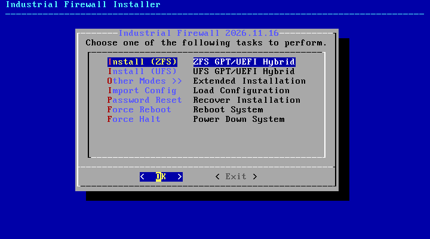

图 1：产品安装器的安装方式选择页；确认目标盘后才会写盘。

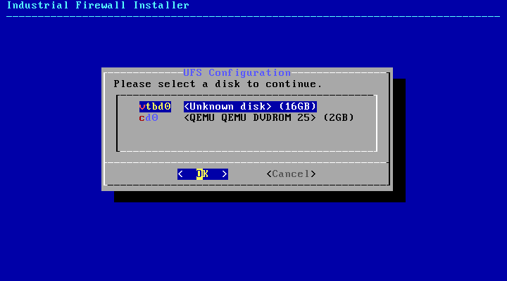

图 2：确认系统盘；选择并确认之前先核对磁盘容量及用途。

## 4. 首次启动和 Web 管理

把管理电脑连入 LAN。可自动获取地址；若没有得到租约，暂设 `192.168.1.10/24`，确保没有同地址冲突。浏览器打开 `https://192.168.1.1/`，以 `root` 和安装过程中设置的口令登录。初始为设备自签名证书：在隔离安装网确认设备身份后方可继续；正式交付建议配置可信管理证书。WAN 默认 DHCP；LAN 应按实际网络规划修改。若 LAN 地址变更，管理电脑需要续租或修改静态地址，再访问新地址。

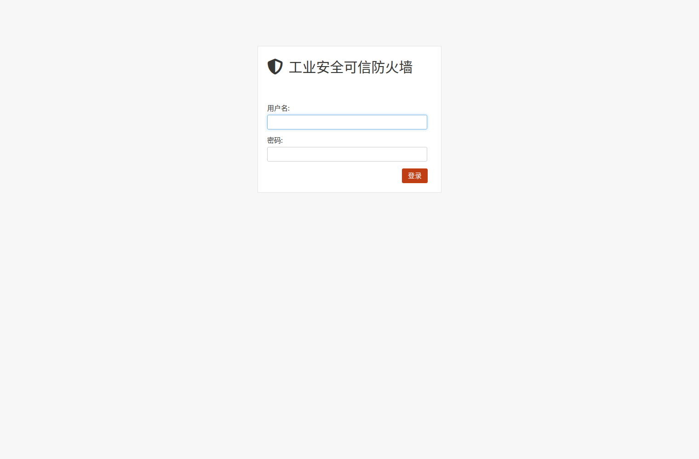

图 3：Web 登录界面。

进入“系统 → 设置 → 常规 / 管理”设置主机名、时区、DNS 和 HTTPS 管理端口。创建日常使用的具名管理账号，按职责分配权限。只有需要命令行时才在“管理”中开启 SSH，限制为管理接口、使用密钥和独立账号。控制台可在 Web 失联时恢复接口地址或管理员口令。系统仪表盘显示资源、服务、流量和日志；右上角“编辑”开启布局调整，拖住卡片下方把手调高，保存后刷新确认。

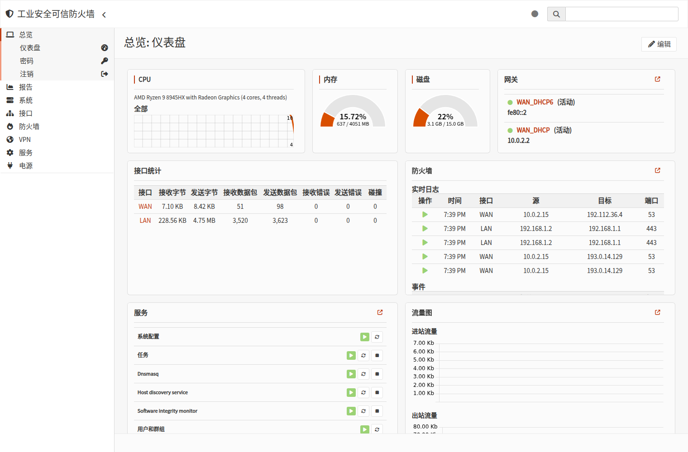

图 4：仪表盘和各卡片的系统状态。

## 5. 网络和原生防火墙

- **接口和路由**：在“接口 → 分配”选择物理端口或 VLAN，在接口页面配置静态地址或 DHCP。“接口 → 概览”核对链路和 IP；“系统 → 网关”核对下一跳。“服务 → Dnsmasq DNS & DHCP”检查 LAN 地址池和租约，避免同一广播域另有 DHCP 服务器；“服务 → Unbound DNS”管理递归解析及本地域名覆盖。
- **访问控制**：在“防火墙 → 规则”选择流量进入的接口，添加规则，填来源、目的、协议和端口，保存并应用。先保留管理访问，再收紧默认 LAN 放行规则。别名适合复用设备网段和端口集合。启用关键规则的日志，在防火墙实时视图核对命中。恢复旧配置带有旧格式规则时，按页面提示检查兼容规则和迁移入口。
- **地址转换**：按照需要设置出站 NAT 或目的地址转换，并核实对应的过滤规则。每次改动从专用客户端同时测试应放行和应拒绝的流量。若表现与规则不符，检查接口方向、命中顺序和已有连接状态。

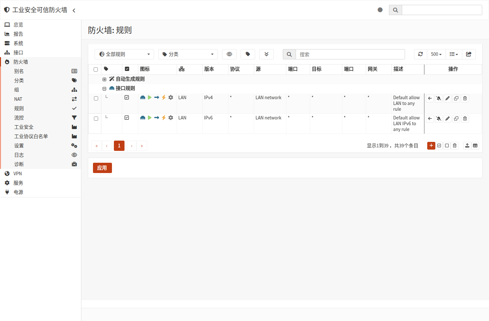

图 5：编辑及应用接口规则的统一入口。

### 入侵检测和防御

进入“服务 → 入侵检测 → 管理”。选择实际承载流量的接口，更新并启用需要的签名集。先以 IDS 模式通流并观察告警和误报，再在隔离环境按网卡能力启用内联 IPS。选用会实际执行阻断动作的策略，分别测试正常流量和验证报文；从客户端观察连接结果，并与引擎日志记录比对。仅 IDS 告警时不应宣称数据包已丢弃。在同一接口上接入生产流量前验证吞吐和丢包。

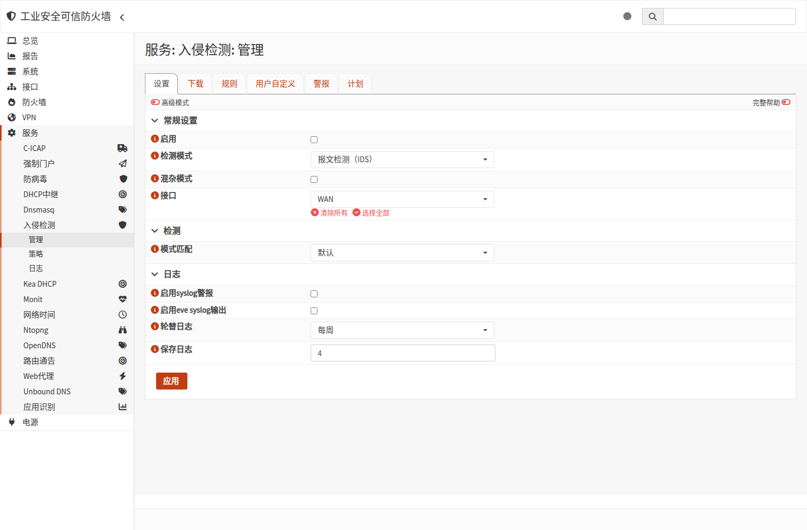

图 6：在入侵检测页面配置采集接口、工作模式和规则。

## 6. 应用识别

1. 在防火墙启用 ntopng 服务并选择监测接口。首次打开采集服务时完成其管理员口令设置，按本机 ntopng 的“用户认证 Token”入口生成 API Token。采集接口应覆盖待识别流量，ntopng 管理端口应限制在管理网络。
2. 打开“服务 → 应用识别 → 连接设置”。同机部署可填 `127.0.0.1:3000`，按实际状态选择 HTTP/HTTPS，填接口 ID 和 Token，保存并点“测试连接”。远程采集服务应使用 HTTPS 并验证证书。
3. “实时流量”用于核对流，进入“应用与识别库”可查看应用统计并管理规则。用同一个列表按名称或“规则来源”筛选系统内置和本地规则。内置域名识别库与预置本地规则均可检索；本地规则可改、停用或删除。如需覆盖内置结果，可新建优先匹配的本地规则。
4. 用“添加”维护单条规则，也可以下载 JSON/CSV 模板、导入原有配置和导出本地规则。批量导入时先用默认的合并/追加策略；相同匹配条件不会重复插入。替换意味着替换本地规则，启用前应先导出。导入后复核提示、应用标签和域名范围；确认匹配真实流量后再批量启用。

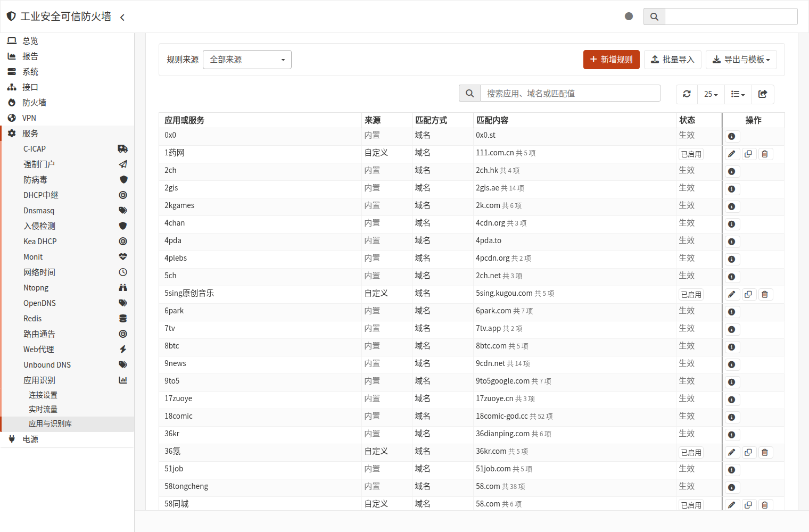

图 7：统一浏览规则，并按规则来源过滤；工具栏提供添加、导入和导出。

最小 JSON 示例：

```json
[
  {"enabled":"1","description":"测试 MES","match_type":"domain",
   "match_value":"mes.example.internal","app_label":"现场 MES"}
]
```

可用匹配类型：`domain`、`ip`、`cidr`、`port`、`protocol`。域名库依据可见主机名和流量元数据，不能解密 TLS；加密 DNS、隐藏主机名、IP 复用或未监测接口都可能影响识别。识别列表是可匹配条目，和现场验证通过的应用数量是两个指标。

## 7. 下载防病毒

1. 打开“服务 → 防病毒 → 防病毒配置与诊断”。在“防病毒配置”选择代理监听接口、端口、允许的客户端地址或网段，以及最大扫描文件大小。只允许需要用代理的来源；设管理规则和客户端访问规则时不要把代理开放给 WAN。
2. 在“病毒库与诊断”启用自动更新。需要出网代理时，只在这里填更新代理主机和端口；不经过代理时清空。点“立即更新”后检查病毒库状态和最近诊断。出厂镜像不附带现场代理地址或病毒库，首次扫描前应完成下载。
3. 点击页面顶部的“启动防病毒”，等待扫描引擎、扫描连接和下载代理为运行状态。停止时用同一位置的停用按钮。用户无需分别配置 ClamAV、C-ICAP 和 Squid。
4. 将客户端的 HTTP 代理设为防火墙所选接口的地址及端口。用“检查扫描链路”验证普通文件放行和 EICAR 测试字符串拦截。该探针构造测试流量，不需要下载真实恶意文件。

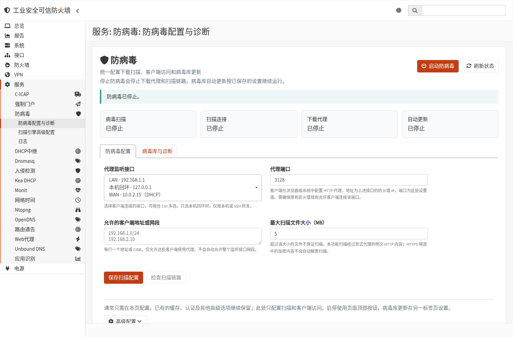

图 8：监听和访问范围在配置页填写；顶部一键控制整个链路。

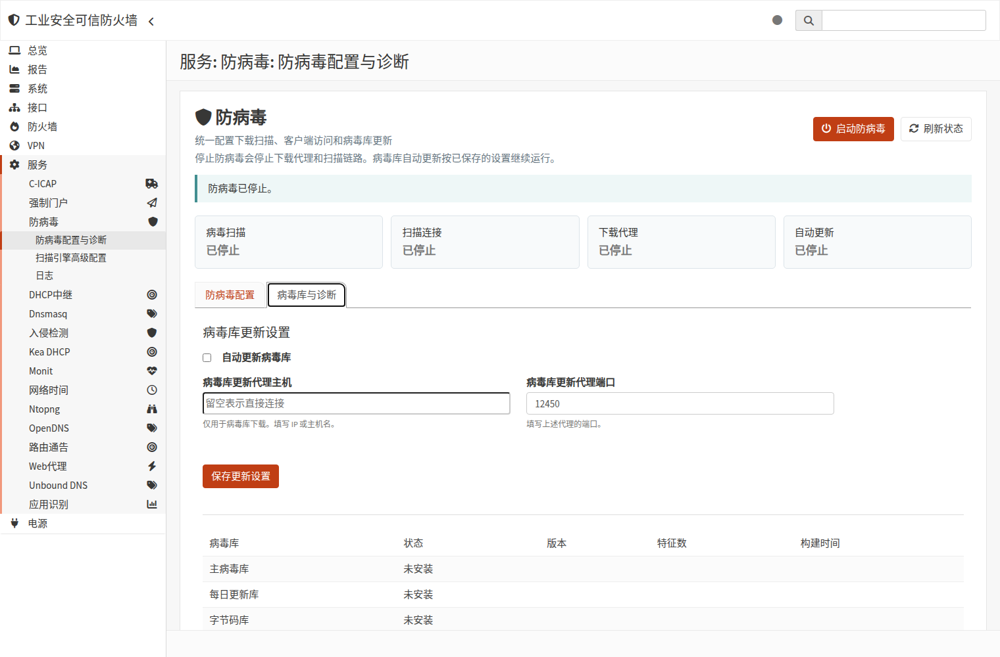

图 9：在独立页配置更新代理和刷新病毒库，检查实际运行状态。

扫描针对通过显式代理的可见 HTTP 下载。直接访问、加密 HTTPS 隧道或超过扫描大小的文件不能据此认定已检查。不要为测试随意关闭 TLS 保护。若启动失败，先查看组件诊断，再核对病毒库、监听地址和客户端 ACL。

## 8. 工业协议白名单与 NC-Link

1. 在“服务 → 入侵检测”先选中工业流量实际经过的接口。
2. 打开“防火墙 → 工业协议白名单”。限定设备或网段、目标端口和协议；为必要的操作码、Unit ID、服务码或 MQTT 方向和主题增加允许规则。
3. 在不影响联机设备的测试范围内先检查告警，再开启默认拒绝并应用。用正常事务和未授权事务各做一次回归。工业协议页日志区分策略动作与引擎实际处置；在线 IDS 仅告警。
4. NC-Link 选择相应 MQTT 规则类型，使用真实设备标识、通道、主题前缀和方向。只放行需要的请求、应答或采集主题。例如允许设备对 `Query/Request/<device>/<ex_cid>` 或 `Sample/<device>/<channel>` 的特定发布/订阅路径；拒绝未授权设备与无关通配订阅。经 TLS 加密且未在受信节点终止的内容不能由防火墙解析。

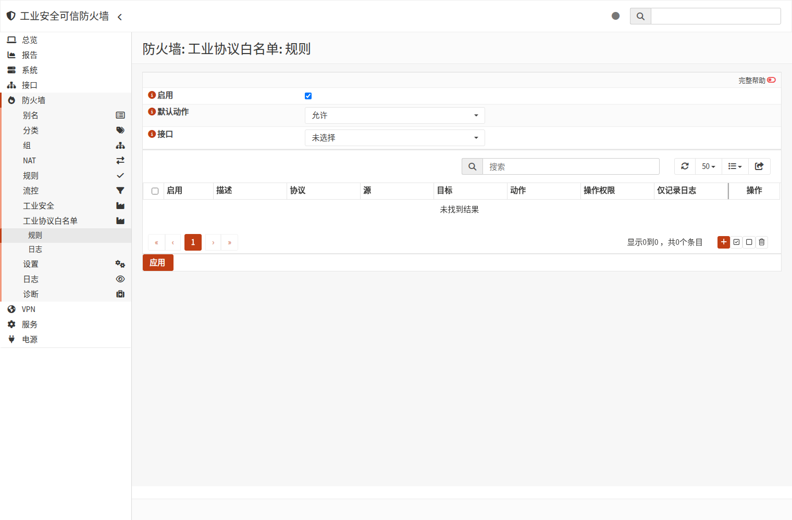

图 10：在规则编辑器配置地址范围、协议和允许的操作。

现有能力涵盖 Modbus TCP、DNP3、S7comm、MQTT、NC-Link、EtherNet/IP/CIP、IEC 104、FINS/TCP、MELSEC MC/SLMP、BACnet/IP、OPC UA TCP。部分规则是有限帧特征；完整能力和版本边界见 [协议说明](../../plugins/security/icsguard/README.md)。本版 NC-Link 策略以 MQTT 主题为主，未宣称可以解析全部 NC-Link 传输或机床内部应用权限。

## 9. 微隔离、软件完整性、集中管理

入口：“防火墙 → 工业安全 → 完整性、微隔离与集中管理”。

- **微隔离**：在“设备分组”为 PLC、HMI、工程站等建立互不重叠的网段或地址对象。在“访问矩阵”只允许必要方向与端口。先保存基础设置、预览生成的策略，再应用，最后从负载两侧测试必要和禁止的通信。管理地址保留独立通道。规则主要约束经过防火墙的流量；同一交换网段内绕过网关的流量需要交换机/VLAN 或其他控制点。现有 PF 状态需到期或经运维确认后定向清除。
- **完整性**：填入受保护文件绝对路径，确认系统来源后建立基线；立即校验或启用定时校验。升级后先核对变更再重新建立基线。当前为软件级检测，无 TPM/TPCM 证明。
- **集中管理**：在各受管节点配置可信 HTTPS 和单独 API 用户，仅授予“Industrial security: managed node”。在管理机输入节点 HTTPS 地址和凭据，预览后下发隔离策略。逐台核查返回值和节点状态。集中管理目前分发隔离策略，不同步设备密钥、文件基线或整套系统配置。

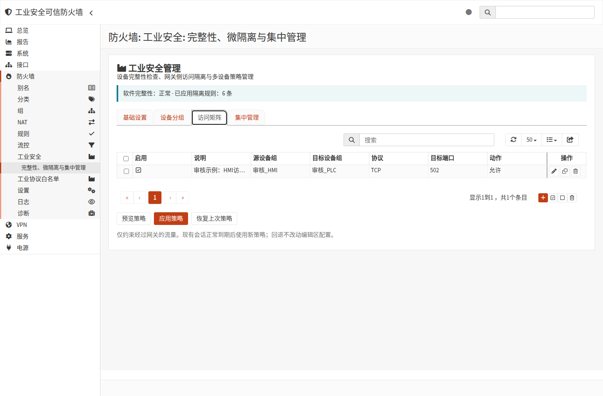

图 11：从设备分组进入访问矩阵，预览和应用策略。

## 10. VPN、高可用与备份

- **IPsec**：在“VPN → IPsec → 连接”建立 IKE 连接。匹配对端认证方式、标识、提议和本地/对端流量选择器；在“状态”中核对 IKE SA 和 Child SA，实测两侧网段通信。确认 UDP/500、UDP/4500 或现场所需 ESP 流量可到达。
- **SSL VPN**：在“系统 → 信任”建立或导入 CA 和服务器证书；在“VPN → OpenVPN → 实例”建立服务器，选择安全的认证方式、隧道地址池、要推送的网段与是否使用 TLS 保护密钥。加对应 WAN 入站规则、VPN 到内网的限制规则。给客户端导出单独配置，确认连接、路由及 DNS；证书吊销后复测。IPsec/OpenVPN 的容量需按实际硬件、算法和流量实测。
- **双机热备**：使用相同交付版本、独立同步网络、各自的真实接口地址、共享 CARP 虚拟地址。在“系统 → 高可用性”设置配置同步和 pfsync；确认接口的 CARP 状态分别是 MASTER/BACKUP。上架验收用测试流量测断链及断电切换，确认流量恢复时间、现有连接及 VPN 重连行为。自定义插件需两端同版。
- **备份**：改动前到“系统 → 配置 → 备份”下载配置，选择密码加密并妥善保存。恢复操作先在同版测试 VM 验证；备份可能包含密钥、证书和密码数据，不可上传源码仓库。升级涉及两台节点时逐台验证。更改插件或核心前保存快照，无可用快照时用本镜像重装和恢复所保留的配置。

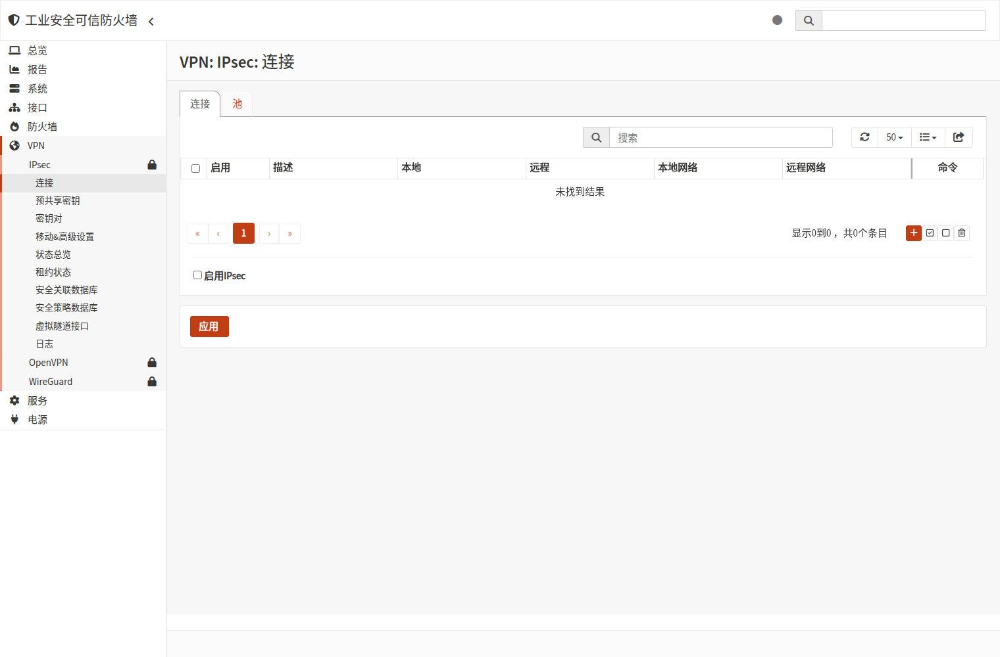

图 12：原生 IPsec 连接及流量选择器。

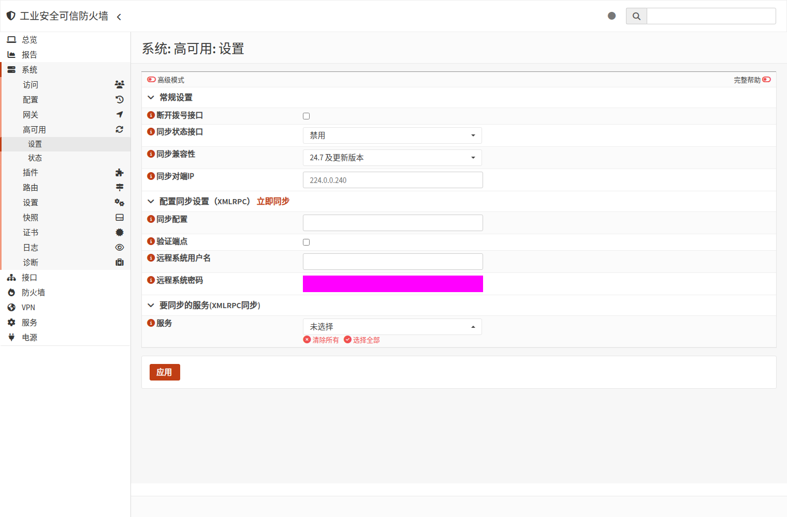

图 13：检查状态同步、配置同步和自定义策略同步选项。

## 11. 插件、命令行和排查

“系统 → 插件”可打开“软件源连接设置”。通过受信代理访问官方签名仓库后刷新目录。对于环境依赖的插件，先在测试机装卸验证；镜像锁定产品 core、定制防病毒和代理软件包，防止被同名上游包覆盖。后续产品升级使用本仓库经验证的镜像或软件包；不要手工解锁并直接覆盖同名定制包。

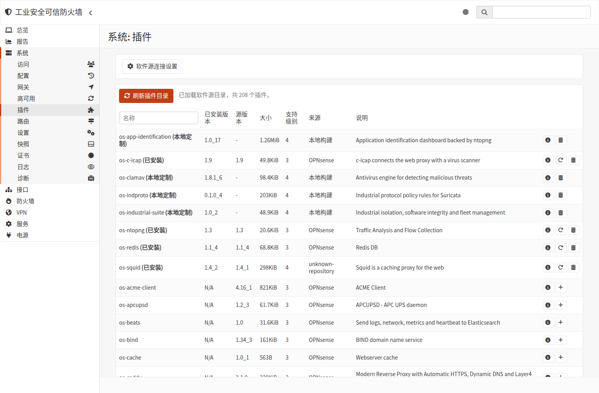

图 14：插件页面的连接设置入口。目录内容随签名仓库版本和网络状态变化。

| 现象 | 优先检查 |
| --- | --- |
| 启动进入旧系统或反复进安装器 | 挂载的是已校验 ISO；首次从光驱启动；安装完成后已弹出 ISO |
| HTTPS 管理页打不开 | 客户端与 LAN 同网段、虚拟交换机正确、没有地址冲突、端口配置正确 |
| DHCP 没发地址 / DNS 不通 | DHCP 地址池和监听接口、是否有第二台 DHCP、客户端网关和 DNS、Unbound 状态 |
| 自定义规则未命中 | 是否应用、规则已启用、匹配类型和可见域名、是否监听目标接口 |
| 白名单有日志却没有拦截 | 实际引擎模式、内联路径、规则动作、既有连接和协议限制 |
| 代理无法下载或未扫描 | 代理地址与 ACL、病毒库状态、客户端实际上是否走 HTTP 代理 |
| VPN 连接失败 | 时钟、证书链、端口、提议、两端标识、客户端路由及防火墙日志 |
| 插件列表空白 | 查系统时间、DNS、上游代理连通性和签名验证结果 |
| 变更后失联 | 用控制台核对网卡和 IP，按预案回退；不要经唯一管理连接临时清空所有规则 |

只读诊断示例（在受控管理终端执行）：

```sh
ifconfig
netstat -rn
/sbin/pfctl -s info
/sbin/pfctl -sr
drill @127.0.0.1 localhost A
configctl industrialsuite status e30=
pkg query '%n %v'
```

设备日志可从“系统 → 日志”“防火墙 → 日志”和各模块诊断访问。报障时提供产品版本、时间、页面或接口、操作步骤和相关日志片段；去除密码、私钥和 API Token。开发及重新构建见 [镜像构建说明](../../tools/release/README.md)。


## 12. 启动与品牌显示

安装器、键盘选择、控制台欢迎语、版本横幅和登录前提示统一显示 Industrial Firewall。常规启动默认采用静默内核输出；需要排查启动故障时，在加载器命令行执行 `unset boot_mute` 后启动，或登录后读取启动日志。

内部软件包名、API 命名空间、分区类型与许可证中的上游标识予以保留，以维持插件、升级工具及系统接口兼容。品牌配置源文件为 `src/opnsense/version/branding.conf`，安装器源码为 `contrib/installer/`。
